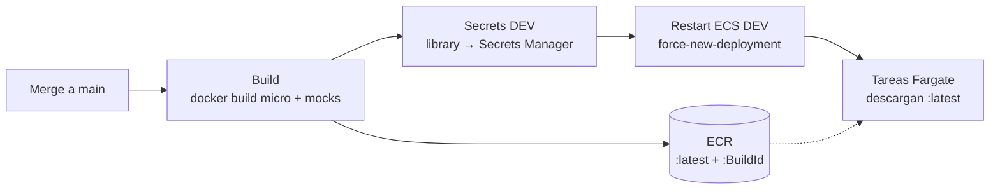

# Estrategia de despliegue · ms-transfers (dev)

Cómo llega el código del micro y de los mocks a ECS Fargate en `dev`. La infraestructura la crea el repo `pragma-iac-tf-pragma-transfer`; este repo solo publica imágenes, escribe secretos y reinicia tareas.

## Idea central: siempre `:latest` + reinicio

- Las task definitions del micro y de mocks (de Terraform) apuntan **siempre** a la imagen `:latest` de su ECR.
- Desplegar es: **subir una imagen nueva con el tag `latest`** y **reiniciar las tareas** (`aws ecs update-service --force-new-deployment`). Las tareas nuevas descargan la `:latest` al arrancar.
- El pipeline **no** registra revisiones de task definition. Por eso Terraform y el pipeline no se pisan.
- Cada imagen también queda con el tag `$(Build.BuildId)` para trazabilidad y rollback.



## Recursos

| Recurso | Nombre | Quién lo crea |
| --- | --- | --- |
| ECR del micro | `pragma-transfers-dev-ecr-ms-transfers` | HU-00 (preexistente) |
| ECR de mocks | `pragma-transfers-dev-ecr-mocks` | HU-00 (preexistente) |
| Cluster, servicios `ms-transfers` y `mocks`, task definitions | outputs de Terraform | `pragma-iac-tf-pragma-transfer` |
| Secreto de las APIs (vacío) | output `secret_apis_name` | `pragma-iac-tf-pragma-transfer` |

## Pipeline (`deployments/azure-pipelines.yml`)

Se dispara con push a `main`.

| Stage | Por defecto | Qué hace |
| --- | --- | --- |
| Quality | **Desactivado** | `./gradlew clean build`: pruebas, ArchUnit y cobertura del 90 % |
| Security | **Desactivado** | Secret scan con gitleaks |
| Build | Activo (solo `main`, no PR) | `docker build` del micro (`Dockerfile`) y de mocks (`mocks/Dockerfile`); push a sus ECR con `latest` y `$(Build.BuildId)` |
| Secrets DEV | Activo (environment `dev`) | Arma un JSON con `CORE_API_KEY`, `FRAUD_API_KEY` y `DIRECTORY_API_KEY` de la library y lo escribe en `$(SECRET_APIS_NAME)` |
| Restart ECS DEV | Activo (environment `dev`) | `update-service --force-new-deployment` de `$(ECS_MOCKS_SERVICE)` y `$(ECS_SERVICE)`; espera a que los dos queden estables |

### Antes de que exista la infraestructura

*Secrets DEV* se salta si la library no tiene `SECRET_APIS_NAME`, y *Restart ECS DEV* se salta si no tiene `ECS_CLUSTER` y `ECS_SERVICE`. Si las variables tienen un valor pero el secreto o el cluster todavía no existen en AWS, la etapa deja una advertencia y termina sin fallar. Así el pipeline queda en verde cuando solo hay que publicar imágenes (HU-01, antes del primer `apply` de la HU-02). En cuanto la library tiene esos valores, las dos etapas corren solas.

### Modo taller: gates desactivados

Para que el despliegue sea rápido en el taller, **Quality y Security no se borran: están detrás del parámetro `runQualityGates`** (por defecto `false`). Para correrlos: *Pipelines → pragma-ms-java-pragma-transfer → Run pipeline → marcar "Correr Quality y Security"*.

Con los gates apagados, el pipeline no corre pruebas: la imagen se compila dentro del `Dockerfile` (`bootJar`) sin `check`. Para producción los gates deben ir encendidos (o `default: true`).

## Acceso a AWS (sin llaves)

1. Cada tarea `AWSShellScript@1` entra con la service connection `$(AWS_SERVICE_CONNECTION)` (OIDC).
2. Asume `$(AWS_DEPLOY_ROLE)` con un perfil del AWS CLI:
   ```bash
   aws configure set role_arn "$(AWS_DEPLOY_ROLE)" --profile deploy
   aws configure set credential_source Environment --profile deploy
   aws() { command aws --profile deploy "$@"; }   # --profile gana sobre las credenciales del entorno
   ```
   El CLI hace el `assume-role`; el script nunca maneja llaves.
3. Cadena de roles (cuenta `123456789012`):

   | Rol | Lo usa | Para qué |
   | --- | --- | --- |
   | `pragma-workshop-peru-devops-role-dev-deploy` | Service connection `aws-service-connection-dev` (OIDC) | Solo puede asumir los dos roles de abajo |
   | `pragma-workshop-peru-devops-role-app` | Este pipeline (`AWS_DEPLOY_ROLE` de la library) | ECR, escribir el secreto de las APIs y reiniciar servicios ECS |
   | `pragma-workshop-peru-devops-role-iac` | Pipeline de IaC (`AWS_DEPLOY_ROLE` de su library) | Crear la infraestructura con Terraform |

Ni la service connection ni el rol están escritos en el YAML: vienen de la library.

## Library `pragma-ms-java-pragma-transfer`

| Variable | Origen |
| --- | --- |
| `AWS_SERVICE_CONNECTION`, `AWS_REGION` | HU-00 |
| `AWS_DEPLOY_ROLE` | HU-00: ARN de `pragma-workshop-peru-devops-role-app` |
| `ECR_REPOSITORY`, `ECR_MOCKS_REPOSITORY` | HU-00 (ECR preexistentes) |
| `ECS_CLUSTER`, `ECS_SERVICE`, `ECS_MOCKS_SERVICE`, `SECRET_APIS_NAME` | Outputs de Terraform, después del primer `apply` |
| `CORE_API_KEY`, `FRAUD_API_KEY` (secretas) | Library; `DIRECTORY_API_KEY` se agrega en la HU-03. El pipeline las escribe en el secreto y el micro las lee de ahí al arrancar |
| `DYNAMODB_*`, `SNS_*`, `*_BASE_URL` | Library; el pipeline las escribe en `application.yml` antes del `docker build` (`deployments/scripts/render-config.py`) |

## Mocks

- `mocks/mappings/` tiene los stubs de WireMock del core bancario y antifraude.
- En local: `docker run --rm -p 9090:8080 -v $PWD/mocks:/home/wiremock wiremock/wiremock:3.9.1`.
- En dev: `mocks/Dockerfile` copia los stubs dentro de la imagen de WireMock (sin NAT, Fargate no puede descargar de Docker Hub). El servicio `mocks` queda en Cloud Map como `mocks.pragbank.local:8080` y el micro lo usa con `CORE_BASE_URL` y `FRAUD_BASE_URL`.
- Cambiar un mock = editar un JSON en `mocks/mappings/` y hacer merge a `main`.

## Orden la primera vez

1. HU-00: ECR, bucket del state, rol, service connection, libraries y environments `main` y `dev`.
2. Pipeline de IaC: crea cluster, servicios, secreto, red, etc. Las tareas fallan hasta que existan las imágenes `:latest`; es esperado.
3. Copiar `ECS_CLUSTER`, `ECS_SERVICE`, `ECS_MOCKS_SERVICE` y `SECRET_APIS_NAME` a la library.
4. Pipeline del micro: sube las imágenes, escribe los secretos y reinicia. Desde aquí cada merge a `main` despliega solo.

Si el pipeline del micro corre antes que la IaC (HU-01), solo publica las imágenes y salta *Secrets* y *Restart*.

## Rollback

1. En ECR, volver a etiquetar como `latest` la imagen anterior (cada build queda con su `$(Build.BuildId)`):
   ```bash
   MANIFEST=$(aws ecr batch-get-image --repository-name pragma-transfers-dev-ecr-ms-transfers \
     --image-ids imageTag=<BuildId anterior> --query 'images[0].imageManifest' --output text)
   aws ecr put-image --repository-name pragma-transfers-dev-ecr-ms-transfers \
     --image-tag latest --image-manifest "$MANIFEST"
   ```
2. Reiniciar las tareas: `aws ecs update-service --cluster <cluster> --service <servicio> --force-new-deployment`.

## Trade-offs aceptados para el taller

- Sin revisiones de task definition no hay rollback desde ECS: el rollback es por tag de imagen.
- Si se sube otra `latest` mientras un servicio reinicia, dos tareas pueden quedar con imágenes distintas por un momento.
- Con los gates desactivados se despliega código sin pruebas.
